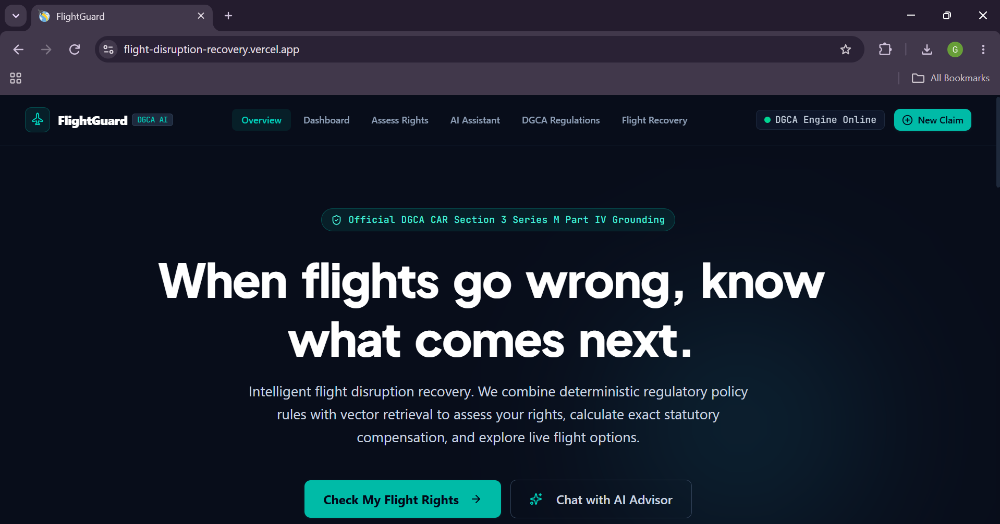
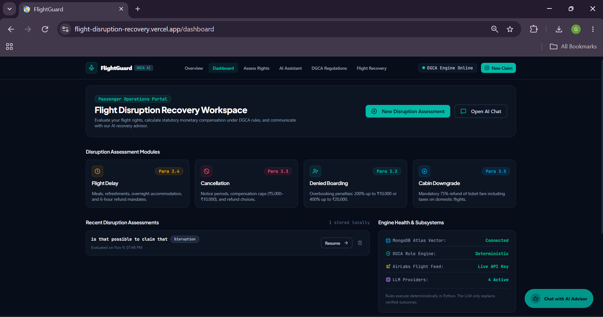
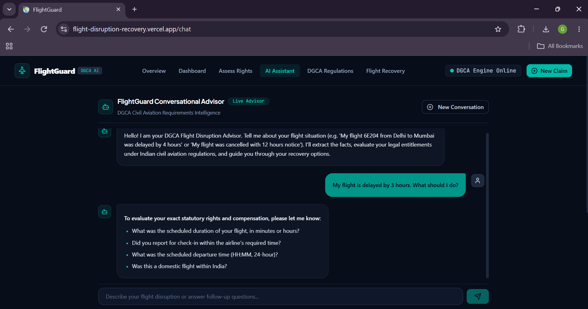
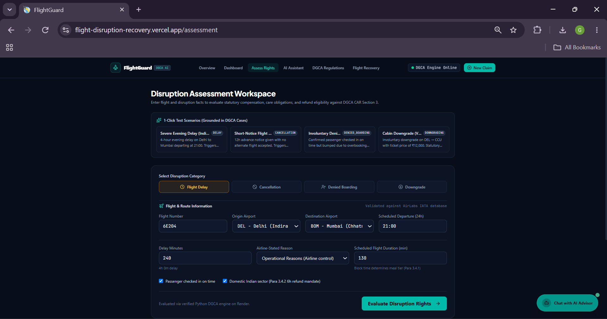
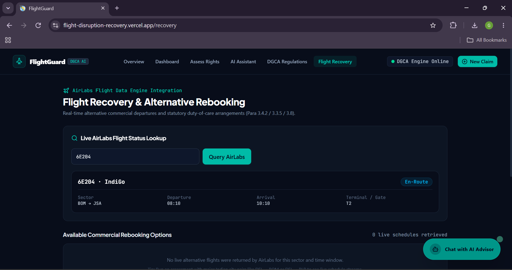
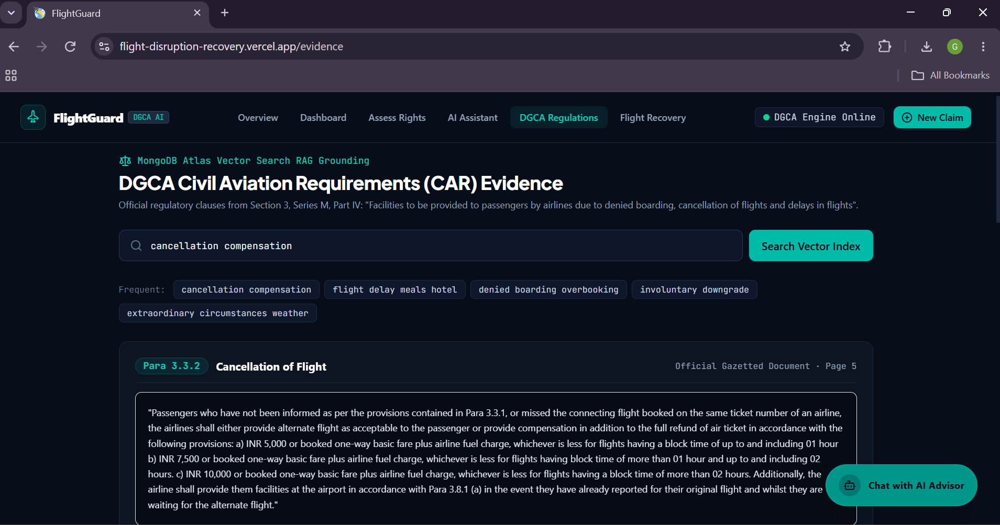

# Flight Disruption Recovery Engine

**An AI-powered, regulation-grounded decision-support platform for flight disruption assistance under Indian DGCA guidelines.**

The Flight Disruption Recovery Engine helps passengers understand potential rights and recovery options when affected by flight delays, cancellations, denied boarding, downgrades, and other flight disruptions.

Built with **React, FastAPI, MongoDB Atlas Vector Search, RAG, and deterministic rule evaluation**, the platform combines regulatory evidence, structured decision logic, and conversational AI.

> **Core principle: The rule engine determines outcomes. The LLM explains them.**

---

## Live Application

| Component | Link |
|---|---|
| Frontend | [Live Application](https://flight-disruption-recovery.vercel.app/) |
| Backend API | [Render API](https://flight-disruption-recovery.onrender.com/) |
| API Documentation | [Swagger UI](https://flight-disruption-recovery.onrender.com/docs) |
| Source Code | [GitHub Repository](https://github.com/Gopika34/Flight-Disruption-Recovery) |

---

## Application Screenshots

Explore the platform's key interfaces.

### 1. Landing Page

<p align="center">
  
</p>

### 2. Flight Disruption Dashboard

<p align="center">
  
</p>

### 3. AI Flight Assistant

<p align="center">
  
</p>

### 4. Disruption Evaluation

<p align="center">
  
</p>

### 5. Alternative Flight Options

<p align="center">
  
</p>

### 6. DGCA Regulatory Reference

<p align="center">
  
</p>

---

## Key Features

- **Regulation-Grounded RAG:** Processes DGCA Civil Aviation Requirements, generates Gemini embeddings, and retrieves relevant policy evidence through MongoDB Atlas Vector Search.
- **Deterministic Rule Engine:** Evaluates supported disruption scenarios against structured regulatory conditions and produces explainable results.
- **Conversational AI:** Extracts passenger information, maintains session context, asks follow-up questions, and streams responses using Server-Sent Events (SSE).
- **Multi-Provider LLM Routing:** Integrates Gemini, Groq, and Mistral with provider fallback and retry handling.
- **Flight Recovery Guidance:** Presents relevant regulatory considerations and potential passenger recovery options.
- **Backend Reliability:** Modular FastAPI architecture, health checks, structured API responses, and automated testing with Pytest.

## System Architecture

```text
             PASSENGER
                 |
                 v
        REACT + TAILWIND
                 |
                 v
              FASTAPI
                 |
                 v
         QUERY PROCESSING
                 |
          +------+------+
          |             |
          v             v
      RAG RETRIEVAL  RULE ENGINE
          |             |
          v             |
    QUERY EMBEDDING     |
          |             |
          v             |
    MONGODB ATLAS       |
    VECTOR SEARCH       |
          |             |
          v             |
     POLICY EVIDENCE     |
          |             |
          +------+------+
                 |
                 v
             LLM ROUTER
                 |
          +------+------+ 
          |      |      |
        GEMINI  GROQ  MISTRAL
          |      |      |
          +------+------+
                 |
                 v
       RESPONSE GENERATION
                 |
                 v
          SSE STREAMING
                 |
                 v
         REACT CHAT UI
```

**Architectural principle:** Regulatory outcomes are evaluated by deterministic rules, while retrieved policy evidence and LLMs support understandable explanations.

## Technology Stack

| Layer | Technologies |
|---|---|
| Frontend | React.js, JavaScript, Tailwind CSS |
| Backend | Python, FastAPI |
| Database | MongoDB Atlas |
| Vector Search | MongoDB Atlas Vector Search |
| Embeddings | Gemini Embedding API |
| LLM Providers | Gemini, Groq, Mistral |
| AI Architecture | Retrieval-Augmented Generation (RAG) |
| Streaming | Server-Sent Events (SSE) |
| Testing | Pytest |
| Deployment | Vercel, Render |
| Version Control | Git, GitHub |

## Repository Structure

```text
Flight-Disruption-Recovery/
│
├── backend/
│   ├── app/
│   │   ├── api/
│   │   ├── core/
│   │   ├── db/
│   │   ├── llm/
│   │   ├── rag/
│   │   ├── rules/
│   │   ├── services/
│   │   └── main.py
│   ├── scripts/
│   ├── tests/
│   ├── requirements.txt
│   └── .env.example
│
├── frontend/
│   ├── public/
│   ├── src/
│   └── package.json
│
├── screenshots/
│   ├── landing-page.png
│   ├── flight-disruption-dashboard.png
│   ├── ai-assistant.png
│   ├── evalute-disruption.png
│   ├── alternative-live-flight.png
│   └── DGCA-regulations.png
│
├── .gitignore
└── README.md
```

## Local Development

### Prerequisites

- Python 3.11+
- Node.js and npm
- MongoDB Atlas account
- Gemini API key
- Optional Groq and Mistral API keys

### 1. Clone the repository

```bash
git clone https://github.com/Gopika34/Flight-Disruption-Recovery.git

cd Flight-Disruption-Recovery
```

### 2. Run the backend

```bash
cd backend

python -m venv venv
```

Activate the environment:

**Windows:**
```powershell
venv\Scripts\activate
```

**macOS/Linux:**
```bash
source venv/bin/activate
```

Install dependencies:

```bash
pip install -r requirements.txt
```

Create a `.env` file using `.env.example` and configure the required database and API credentials.

Start the server:

```bash
uvicorn app.main:app --reload
```

Backend: `http://127.0.0.1:8000`

API documentation: `http://127.0.0.1:8000/docs`

### 3. Run the frontend

Open a separate terminal:

```bash
cd frontend

npm install

npm run dev
```

Build for production:

```bash
npm run build
```

Configure the frontend API URL using the appropriate Vite environment variable.

## API Reference

| Method | Endpoint | Description |
|---|---|---|
| GET | `/health/live` | Liveness check |
| GET | `/health/ready` | Readiness check |
| GET | `/search` | Regulatory policy retrieval |
| GET | `/flights/{flight_number}` | Flight information |
| POST | `/evaluate` | Deterministic rule evaluation |
| POST | `/recover` | Recovery assistance |
| POST | `/ask` | Conversational AI |
| POST | `/ask/stream` | Streaming AI response |

See the [interactive API documentation](https://flight-disruption-recovery.onrender.com/docs) for endpoint schemas and details.

## Testing

Run the backend validation and test suite from the `backend` directory:

```bash
python -m compileall -q app tests scripts

python -m pytest -q
```

**Latest recorded test results:**

- 141 passed
- 1 skipped
- 22 deselected
- 2 warnings

*These results represent a recorded test run and may change with subsequent updates.*

## Deployment

| Component | Platform |
|---|---|
| Frontend | Vercel |
| Backend API | Render |
| Database | MongoDB Atlas |

Production credentials and API keys are configured through environment variables and are not committed to the repository.

## Regulatory Reference

**Directorate General of Civil Aviation (DGCA)**

Civil Aviation Requirements (CAR), Section 3 – Air Transport, Series M, Part IV, Revision 4.

Effective date: 15 February 2023.

The regulatory document serves as the policy knowledge base for the implemented rules. Regulatory applicability should be checked against the latest official requirements before relying on any guidance.

> **Disclaimer:** This platform provides regulatory information and decision support. It does not perform flight bookings, guarantee compensation, or replace official airline or regulatory decisions.

## Future Enhancements

- Expanded regulatory coverage and automated policy updates.
- Enhanced real-time flight information integration.
- Passenger document ingestion and extraction.
- Multilingual AI assistance.
- Retrieval evaluation and production observability.

## Author

**Gopika S.**  
B.Tech – Artificial Intelligence and Data Science, 2026

Full-Stack Developer | AI & RAG Systems

- [GitHub](https://github.com/Gopika34)
- [LinkedIn](https://www.linkedin.com/in/gopika-s-2501b0244/)

---

If you find this project interesting, consider giving the repository a star!